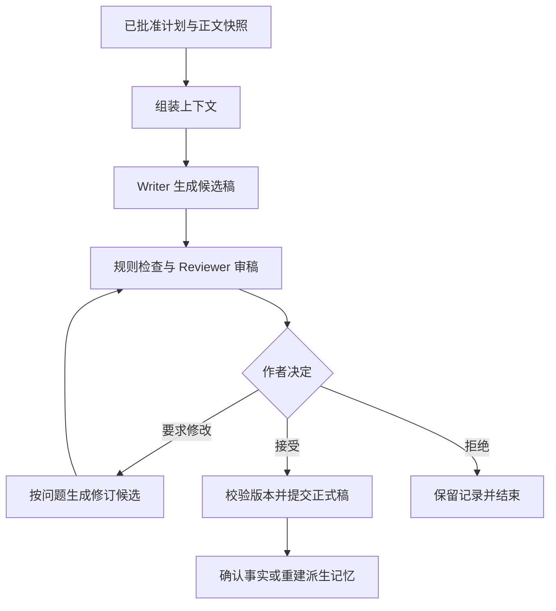

工作名：novel-engine。规划日期：2026 年 10 月 28 日。

项目采用 TypeScript 开发可独立运行的小说创作核心，通过 CLI 在本机或 Linux 服务器上调试。先实现规划、写作、审稿、人工接受和导出的完整流程，再加入长篇记忆、局部修订和改稿影响分析。本文描述各阶段的目标设计，当前实现范围与验证状态见 [ROADMAP.md](ROADMAP.md)。

当前开发范围是单用户、API 模型、单个 TypeScript 工程。客户端、Web 界面和多人 SaaS 属于后续接入层；本轮里程碑围绕核心业务与 CLI 展开。

# 1 版本目标

| 版本 | 作者能够完成的事情 | 完成边界 |
| - | - | - |
| v0.1 写作闭环 | 从创作要求得到三章计划，逐章生成、审稿、接受并导出 | 候选稿与正式稿隔离；每步可检查；基本版本保护、请求预算和日志可用 |
| v0.2 长篇与改稿 | 在已有稿件上继续写作，维护人物与事件事实，查看旧章修改对后文的影响 | 来源可核对；失效记忆不被继续使用；局部修改可预览、部分采纳和撤回 |
| v0.3 运行可靠性验收 | 在已有恢复能力上通过故障注入、并发与长链路回归 | 已保存结果可复用；正式提交幂等；同小说写入受控；费用记录覆盖全部尝试 |

从 M0 到 M4 得到 v0.1，M5 到 M6 得到 v0.2，M7 完成 v0.3 的可靠性验收。M1 实现事务和版本保护，M2 实现请求记录、预算、取消和未知结果处理，M3 到 M4 实现人工暂停后的恢复、已保存步骤复用与同书运行所有权。M7 负责故障注入与完整恢复验证，不作为这些基础能力的首次实现节点。

首个价值假设是：在正文质量不下降的前提下，这套流程能减少作者完成三章正文所需的人工修稿时间。根据本轮连续实现 M0～M7 的授权，工程实现和效果验收分别推进：M4 后允许继续实现和离线验证 M5、M6，但没有真实模型与作者评测证据时，不宣称长篇效果或产品验收通过。

# 2 参考项目与取舍

| 项目 | 参考机制 | 本项目的最小实现 |
| - | - | - |
| [InkOS](https://github.com/Narcooo/inkos) | TypeScript 的产物契约、候选和正式版本、上下文来源与预算、状态增量处理 | Zod 契约；候选稿引用固定版本；纯函数计算状态变化；每次调用保存上下文清单 |
| [Novel OS](https://github.com/mrigankad/Novel-OS) | 策划、写作、编辑、核查的职责分工，确定性检查与模型审稿配合 | 先做 Planner、Writer、Reviewer；事实抽取作为固定步骤；规则检查先运行 |
| [Novel factory](https://github.com/YoRengzh/Novel-factory) | 章节契约、人物与物品台账、证据定位、明确的生产流水线 | 一章的目标、出场角色、硬约束、待推进事件、输出范围；问题必须指向具体原文 |
| [NovelForge](https://github.com/RhythmicWave/NovelForge) | 结构化内容和按需上下文引用 | 用明确类型表示人物、设定、章节计划；通过稳定 ID 选择所需信息 |
| [Biz Novel Studio](https://github.com/ExplosiveCoderflome/AI-Novel-Writing-Assistant) | 运行版本和实际模型请求预算；贡献者另有逐项审批与部分批准实现报告 | 每次付费请求都先经过预算控制；提案绑定版本；统一提交；部分采纳后重新校验余项 |

这些项目作为设计参考，按模块独立实现自己的核心。InkOS 当前主分支是 2.0 开发线，参考时固定源码提交，不直接追随主分支变化。Novel OS、Novel factory 的实现语言不同，采用其流程和数据边界。

优先阅读 InkOS 固定提交 53adac4e974b54dafda975edc4edd07cad364c18 中的三个文件：[产物契约](https://github.com/Narcooo/inkos/blob/53adac4e974b54dafda975edc4edd07cad364c18/packages/core/src/harness/contracts.ts)、[状态更新](https://github.com/Narcooo/inkos/blob/53adac4e974b54dafda975edc4edd07cad364c18/packages/core/src/state/state-reducer.ts)、[上下文编译](https://github.com/Narcooo/inkos/blob/53adac4e974b54dafda975edc4edd07cad364c18/packages/core/src/harness/context-compiler.ts)。借鉴契约、版本、来源与预算设计时，另行实现适合插章、倒叙和旧稿修改的状态规则，避免把章序递增直接当作故事时间递增。

补充阅读：[Novel factory 的人工批准节点](https://github.com/YoRengzh/Novel-factory/blob/1db42713a004d1f86be4fc2572822032534b6ce6/novel_factory-domain/src/main/java/cn/novel/yonren/domain/novel/service/armory/node/PlanApprovalGateNode.java)用于理解保存进度后退出执行、由后续批准恢复的流程；[Biz 的请求预算模块](https://github.com/ExplosiveCoderflome/AI-Novel-Writing-Assistant/blob/7f06e54b4fa10517497877f7a69e52be7b346ef3/server/src/platform/llm/retries/RequestBudget.ts)用于理解为什么重试、修复和协议回退都要消耗预算。

# 3 技术选型

| 部分 | 选型 | 用途 |
| - | - | - |
| 运行时 | Node.js 24 LTS 的最新补丁版本 | 固定运行环境，在首次建仓时记录精确版本 |
| 语言 | TypeScript strict 与 ESM | 明确领域类型、状态和模块边界 |
| 包管理 | npm 与 package-lock.json | 单工程、单锁文件，使用 npm ci 重现依赖 |
| 开发与构建 | tsx 与 tsc | 开发时直接运行，发布时编译 |
| CLI | Commander | 子命令、参数和帮助信息 |
| 模型调用 | AI SDK 与一个实际需要的 provider adapter | 统一文本生成、结构化生成、取消和用量信息 |
| 校验 | Zod | 校验配置、模型输出和持久数据；推导 TS 类型 |
| 存储 | SQLite 与 better-sqlite3 | 正文版本、提案、任务、来源和用量；显式 SQL 与迁移 |
| 测试 | Vitest | 假模型、固定响应回放、数据库与 CLI 集成测试 |
| 日志 | 自有结构化 JSON 记录及 JSONL 导出 | 先统一字段与可追踪性，后续再接日志平台 |

截至核查时，[Node 官方发布页](https://nodejs.org/en/about/previous-releases)将 v24 标为 LTS。选型使用这个已确认的稳定分支。依赖的精确小版本在 M0 安装和兼容性检查后写入锁文件。

[AI SDK 结构化输出文档](https://ai-sdk.dev/docs/ai-sdk-core/generating-structured-data)当前属于 v7 文档线。业务模块只依赖本项目的 ModelGateway，不直接依赖各版本 SDK API。正文用文本输出，计划、事实和审稿报告用结构化输出。

[OpenAI 兼容适配器](https://ai-sdk.dev/providers/openai-compatible-providers)提供统一接入方式，但上游对结构化输出、工具调用、流式用量的支持需要逐模型验证。第一版支持一个真实供应商和 FakeProvider；以后按相同契约增加供应商。

首版使用显式工作流状态机。出现大量动态分支、多个长期人工暂停点或跨进程图调度需求后，再评估 [LangGraph.js 的持久化能力](https://docs.langchain.com/oss/javascript/langgraph/persistence)。它的执行检查点与小说正文、事实的业务版本仍需分别管理。

# 4 核心流程



自动修订最多一轮作为初始策略；仍有问题时停在候选稿，等待作者决定。作者主动要求的新一轮修改是新的受预算控制的任务。

工作流由程序调度。Agent 接受固定输入并返回产物，正式正文、计划和事实由 CommitService 统一提交。角色可以共用同一个模型，重点是输入范围、职责和输出结构清楚。

| 模块 | 责任 | 产物 |
| - | - | - |
| Planner | 将创作要求分解成三章计划和本章目标 | ChapterPlan 提案 |
| Writer | 在批准的约束内写一章，或按指定问题修订 | 候选正文版本 |
| Reviewer | 根据规则、计划与来源检查问题 | 带证据的 ReviewReport |
| FactExtractor | 从指定版本抽取人物、事件和事实 | 待确认的事实及来源 |
| ContextBuilder | 选择正文、事实、计划并控制输入预算 | ContextSnapshot 与来源清单 |
| WorkflowRunner | 推进步骤、保存检查点、处理取消和失败 | Run 与 StepAttempt |
| CommitService | 验证提案、应用修改、更新版本、使派生数据失效 | 新正式版本与审计记录 |

FactExtractor 首先作为固定模型步骤实现；达到需要自主查询、追问或多步工具调用时再扩展。早期业务不依赖角色自由聊天。

运行状态区分 queued、running、awaiting_approval、succeeded、failed、cancelled 和 stale。等待人工批准时保存数据并退出 CLI；后续批准或 resume 再启动执行，不让进程一直等待人的输入。运行执行成功、审稿完成、正文被接受是三个不同状态。

# 5 目录与依赖边界

| 目录 | 内容 |
| - | - |
| src/cli | CLI 参数解析、结果展示和退出码 |
| src/domain | Project、ChapterRevision、Fact、Proposal、Run 等契约 |
| src/application | 导入、规划、写作、接受、修订、导出等业务服务 |
| src/workflows | 显式步骤、运行状态、恢复入口 |
| src/agents | Planner、Writer、Reviewer、FactExtractor 的输入输出适配 |
| src/context | 上下文选择、预算、快照和来源清单 |
| src/llm | ModelGateway、真实 provider、FakeProvider、用量和请求预算 |
| src/storage | SQLite 连接、显式 SQL、事务与 migrations |
| src/review | 证据定位、约束检查、问题分类 |
| src/proposals | 修改组、版本校验、差异预览、部分采纳 |
| prompts | 有版本号的提示词模板 |
| tests 与 fixtures | 领域测试、数据库集成、固定响应和小型小说样例 |
| docs | 开发计划、架构决定、CLI 说明 |

CLI 只调用 application 层；application 调用工作流及领域服务；Agent 通过只读快照和 ModelGateway 工作。Agent 不持有 SQLite 写连接。初期保持单包工程，只有存在第二个真实调用入口或独立发布需求时再拆包。

工作区建议由一个 novel.db 保存权威数据，exports 保存可重新生成的 Markdown 或 TXT，debug 保存可重新导出的调试记录。导出文件不作为另一份可自动回写的权威正文；外部修改需要通过显式 import 或 chapter replace 生成新版本。

# 6 数据模型与一致性规则

| 对象 | 最小字段或约束 |
| - | - |
| Project | id、title、language、currentVersion、schemaVersion |
| ProjectRevision | 不可变 id、projectId、version、parentVersion、章节有序清单及正文 revisionId、已批准计划与作者约束的版本引用 |
| Chapter | 稳定 id、显示顺序、当前正式 revisionId；插章只改顺序，不改身份 |
| ChapterRevision | 不可变 id、chapterId、parentRevisionId、content、contentHash、来源 runId |
| ChapterPlan | revisionId、目标、场景、角色、约束、待推进事件；批准后才参与写作 |
| ReviewReport | id、被审稿 revisionId、reviewed 或 failed 或 unavailable 状态、问题和证据；审稿失败不能等同于没有问题 |
| FactClaim | 主体、关系、值、事实种类、来源引用、故事时间或事件顺序、确认状态 |
| Proposal | id、kind、baseProjectVersion、目标正文版本、修改组、依赖、状态 |
| Run 与 StepAttempt | 输入快照、步骤状态、尝试次数、模型配置、原始结果、校验结果、用量 |
| DerivedMemory | 摘要或索引、来源版本集合、构建版本、fresh 或 stale 状态 |

## 项目历史快照

每次权威数据提交都在同一事务里写入不可变 ProjectRevision，并更新 Project.currentVersion。快照至少保存该版本的章节有序清单、每章正式 revisionId，以及计划和作者约束的版本引用；章节当前指针只是便于查询的投影。未接受的候选不进入快照。

按版本导出只读取对应快照和不可变正文修订，不读取最新章节顺序或当前正文指针。初版每个版本保存完整清单，不引入事件溯源；正文内容继续由 revisionId 引用，不重复复制。插章、重排、修改计划和修改正文都必须形成新项目版本。Run 绑定项目快照及实际 ContextSnapshot，保留当时的输入依据。

验收样例连续执行旧章替换、插入新章和重排，再导出操作前后的版本；各版章节集合、顺序与正文均须匹配预期，重复导出结果一致。

## 正式版本与派生数据

SQLite 中的正式正文版本、已批准计划和作者独立声明的约束是权威数据。摘要、检索索引及从正文抽取的事实都要跟踪来源版本。抽取事实即使已经人工确认，来源正文变化后也必须进入待复核状态并停止注入。作者独立声明的约束另行管理，不因正文变化自动消失。

正文提交与相关旧记忆的失效标记在同一数据库事务里完成。后续生成不得注入 stale 记忆：可以重建，或者回退到预算允许的正式原文。失效至少区分追加新章与改动旧内容：追加新章不使来源正文未变的旧章摘要和事实过期，只新增该章抽取任务，并使依赖全书或当前状态的汇总失效；修改旧正文、重排章节或改变作者约束时，初版允许保守地使全作品派生记忆失效。确认正确后再增加精确依赖失效，不提前引入复杂依赖图。

新章接受时，事实若已人工确认且仍对应这份未改变的候选版本，可在同一事务中提交。事实还未确认则保留待处理状态，后续上下文可以使用已接受正文。部分采纳先形成实际待接受的新候选，再对它执行检查、审稿与事实提取；不能直接提交完整候选稿的报告、摘要或事实。

## 提案提交

部分采纳分为“选择并生成新候选”“检查与审稿”“批准提交”三个动作。`proposal select` 根据基线和选定修改组生成新的不可变候选及提案修订，记录所选组及结果内容摘要，不改正式稿；新候选必须获得绑定自身 revisionId 与内容摘要的检查及审稿产物后才能批准。即使完整候选已经通过审稿，也不能沿用它的报告批准部分结果。检查修改组依赖不能替代对实际结果的审稿。

`proposal approve` 只做本地校验和提交，不隐式发起付费模型请求；`--groups` 不直接用于批准。修改选择或正文会产生新的候选、报告绑定和批准身份。全量采纳也执行相同的版本绑定校验。

1. 核对项目版本、章节版本、目标段落和原文哈希。

2. 检查所选修改组的依赖是否完整，是否触碰锁定内容。

3. 在内存中构造结果并运行确定性检查。

4. 在短事务中再次核对版本、提案状态和检查报告绑定，使用 expectedVersion 条件更新或等价 CAS 保证只有一个提交成功；写入新修订与 ProjectRevision、记录批准和幂等键，同时使相关派生信息失效。这条保护从 M1 实现，审稿绑定校验在 M4 接入。

5. 提交完成后处理可重建的记忆和导出。

部分批准会推进项目版本，原提案中未应用的部分随后标记为需要重新校验。撤回通过创建恢复内容的新版本完成，保留历史。

批准请求的默认幂等身份由 projectId、proposalRevision、提案保存的 baseVersion、候选 revisionId 与内容摘要、排序后的修改组稳定生成并持久化。同一请求重试先查已提交结果，再判断当前版本；不同参数不能复用同一身份。剩余修改经过重新校验后获得新的提案修订和批准身份。

模型生成或修订的正文只有在存在绑定该候选 revisionId 的有效检查与审稿产物时才能被批准；报告缺失、不可用、引用校验失败或属于旧候选时暂停。主观意见可以由作者记录处理理由。导入和作者手工替换使用独立的提交类型及检查，不能由 Agent 自行切换类型绕过规则。

## 来源引用

引用至少包含 chapterId、revisionId、blockId、quote。需要位置偏移时明确采用 JS UTF16 偏移，并记录原文哈希。程序检查引用存在且定位唯一；必要时要求起止位置，避免同一句重复出现时匹配错误。原文中能找到一句话不代表它语义上支持结论，报告仍需区分原文事实、模型推断和作者决定。

# 7 长篇记忆与上下文

M4 先使用批准计划、作者硬约束和少量已接受章节原文，跑通三章闭环。M5 再引入摘要、结构化事实和检索。

M0～M7 与工作台交付后的记忆改造按 [小说记忆系统执行计划](docs/implementation/story-memory-plan.md) 推进。该阶段先建立场景、事件、人物认知、叙事披露和各 Agent 的上下文规则，再完善来源依赖与工作台，最后验证 Hindsight 作为可替换检索服务的接入。SQLite 继续管理权威正文与作者决定；下面保留初版约束，后续阶段的具体范围和验收以该执行计划为准，当前进度见 ROADMAP。

上下文按任务组装，保存每个片段的来源、版本、选择理由和估计 token 数。优先顺序是：作者硬约束、本章目标、当前视角允许使用的信息、相关人物与事件事实、最近正文、必要的远处原文。

硬约束不允许静默截断；它们本身超预算时明确失败。摘要和一般背景可以压缩，但保留来源。为输出和工具调用预留空间，不能把模型的全部上下文窗口填满输入。只有字符数估算时使用保守余量，并区分估算 token 与供应商实际 usage。

第一版先通过角色 ID、事实类型、章节范围和关键词定位信息，再根据结果决定是否增加向量检索。中文检索需要单独验证分词、别名和命中情况，不能默认通用全文索引就能解决。

至少区分三类信息：已发生事实、作者计划中的未来事件、某角色相信的内容。故事发生时间、叙述顺序、角色获知时间分别表示；尚无法确定的时间关系保留 unknown。没有找到获知经过时提示待核查，不直接判定角色绝不知情。基础流程先验证线性叙事；倒叙、隐藏身份和误信进入专门回归集。

事实关系需要明确单值与多值，例如角色当前所在地点与持有的多个物品不能采用同一种覆盖规则。初版只支持已定义关系，新增关系类型通过显式 schema 变更加入。

# 8 分阶段开发与验收

按单人开发、熟悉 TypeScript、使用模型 API、无 UI 的条件估算，M0 到 M4 约 8 到 15 个有效开发日；完整 M0 到 M7 约 20 到 35 个有效开发日。这是待验证的范围估算，不是交付承诺。完成 M1 后按实际投入重新估算，M5、M6 的语义规则与人工评测单独计时。推进条件以验收为准，学习工具、模型调试和真实文稿复杂度会增加时间。

## M0 建立可重复运行的工程

目标：创建 TypeScript 单包工程，能够构建、测试和运行 CLI。

任务：先建立项目 AGENTS.md 和 ROADMAP.md，再固定 Node 与必要依赖；建立 strict、ESM、tsx、tsc、Vitest；实现 help 与 doctor 的离线检查；定义文本、结构化输出与取消信号的最小 ModelGateway，提供 FakeProvider；准备一个三章小样例的元数据。README 仅记录已经可运行的能力。

M0 的 doctor 未指定配置文件时检查内置 FakeProvider 配置；显式指定 `--config` 时读取并校验该文件，缺失、损坏或不支持的字段必须失败且不输出配置值。配置和样例均不含真实密钥。SQLite、AI SDK 和真实供应商适配器在对应里程碑才安装。

演示：npm ci、npm run check、npm test、npm run build、npm run novel -- doctor --offline。

验收：新目录可重现安装；离线 doctor 和普通测试不调用外网；显式指定但缺失或无效的配置给出可理解的错误；FakeProvider 覆盖文本、结构化校验与取消；导入模块不会自动调用模型或执行 CLI。分别验证开发入口和编译入口。

## M1 小说工作区与版本

目标：创建项目，导入、查看、修改和导出稿件，暂不依赖模型。

任务：建立 SQLite 迁移；实现稳定章节 ID、不可变修订、ProjectRevision 快照、当前版本指针和 CommitService 基础；确定性拆章并支持预览；保留导入原始文件与编码信息；支持按指定快照导出。

演示：导入三章，修改一章，分别导出修改前后的版本。

验收：重复导入同一来源不意外复制；正文内容按约定换行规范还原，原始文件字节可追溯；插章不破坏 ID；改章、插章和重排后历史导出仍保持旧版内容与顺序；事务内的 expectedVersion 校验阻止旧版本覆盖新版本；迁移失败不破坏现有数据。

## M2 模型网关与运行追踪

目标：真实模型和 FakeProvider 经过同一入口调用，失败可定位。

任务：实现文本与结构化输出、超时取消、schema 校验、请求记录、有限重试和预算；调用前保存 attempt，返回后先保存原始结果再解析；统一管理 SDK 内部重试；提供最小 run inspect，取消状态持久化且阻止本任务后续提交；models probe 检测指定模型能力。准备并冻结第一版人工参考集、对照参数和效果验收阈值。

演示：假模型返回有效结果、错误 JSON 和超时；随后用一个真实模型运行小型能力探测。

验收：坏输出不写正文；修复与重试都计入预算；缺失 usage 记为未知而非零；密钥不进入日志；结果不明的远端请求不会自动被当作没有发生。

## M3 规划与单章候选稿

目标：从创作要求生成三章计划，接受计划后写出第一章候选。

任务：实现 Planner、Writer、本章契约、最小 ContextBuilder；计划通过通用提案接受；候选正文保存为不可变修订；提供 dry run 查看上下文而不请求模型；从本阶段引入同书单写任务所有权与过期结果拒绝。

演示：修改第二章计划后接受，再生成第一章，拒绝一次候选并重写。

验收：未批准计划不进入 Writer；每次生成都固定计划和正文版本；候选不会自动变成正式稿；拒绝稿不会混入后续章节。

## M4 完成可用的写作闭环

目标：写作、检查、审稿、事实提取、人工接受、导出完整可用。

任务：加入 Reviewer、FactExtractor；先运行来源、版本、锁定内容等确定性检查；问题分为确定冲突、待核查和风格建议；作者可要求一次自动修订；最终审稿和事实提取绑定最终候选版本。实现最小 run resume，支持人工等待后继续、复用已保存步骤以及重新校验输入快照和运行所有权。

演示：完成三章，第二章退回修订一次，再逐章接受并导出。

验收：导出内容、正式正文和来源版本一致；接受、拒绝和重新生成都有记录；只使用正式正文和已确认信息；审稿不可用会暂停流程，不能因问题数组为空而放行；格式或引用定位错误阻止提交，主观风格意见允许作者记录理由后继续。

工程验收通过后记录 v0.1 的实现状态。真实模型凭据和人工评测条件齐备时执行效果对照；条件不足时记录待验证原因，并按本轮授权继续后续工程实现。三章离线导出成功不能作为创作效果通过的证据。

## M5 长篇记忆与来源

目标：续写时按任务提供相关信息，并在修改旧稿后识别失效记忆。

任务：加入人物别名、事实、事件、开放伏笔和章节摘要；保存来源版本；实现 memory status、memory rebuild、context show；加入章节范围与角色检索，准备有限的知情边界。

演示：把第一章的一个事实改掉，下一次续写识别失效摘要，重建后使用新事实。

验收：追加新章不重新抽取全部旧章，修改旧来源后旧事实不继续进入新上下文；未来计划不被当作已经发生；超预算不静默删除硬约束；人工可纠正抽取错误并看到来源；倒叙样例不靠章号推断故事先后。

## M6 局部修订与改稿影响

目标：对已有稿件提出带证据的影响清单和修改组，支持部分采纳。

任务：实现影响分析；先按人物、事实和原文检索候选范围，再让模型判断；区分直接冲突与需要作者判断的因果影响；以目标版本、原文锚点、替换内容、理由、证据和依赖构成提案。

演示：推迟一个角色得知秘密的时间；系统指出相关后文；作者批准三组中的两组；撤回后重新继续写作。

验收：锁定段落零修改；旧提案被明确拒绝或重新生成；部分采纳生成新候选，并重新检查、审稿和抽取实际结果的记忆；完整候选通过但部分结果产生矛盾的样例不能沿用旧报告批准；依赖不完整的修改组无法单独应用；引用和影响判断能分别核对。

## M7 恢复与回归

目标：完成中断、取消、重试、并发冲突和长链路回归的验收。

任务：补齐 run inspect、resume 的故障覆盖并实现离线 replay；集中验证同书运行所有权恢复、提交时的所有权与版本复核、迟到响应和取消；数据库事务不跨越模型等待；扩展故障注入点和长链路人工参考集。基础记录、恢复和单书写入控制已在 M2 到 M4 实现。

演示：模型响应保存后杀掉进程，重启继续；请求期间中断后显示 unknown；同时启动两次同书写作；完成十章中途修改与导出。

验收：成功保存的步骤被复用；同一批准不会重复提交；失效运行的迟到响应不能覆盖正文；取消可阻止本地提交；未知远端请求保留费用不确定性；运行完成与稿件质量通过分别记录。

# 9 目标 CLI

下面是待实现接口示例，尖括号中的值由实际命令返回。不同命令通过同一个 project 路径选定工作区。

```bash
npm run novel -- init ./books/demo --title "试验小说"
npm run novel -- --project ./books/demo import ./examples/manuscript.md --preview
npm run novel -- --project ./books/demo import ./examples/manuscript.md --apply
npm run novel -- --project ./books/demo --config ./novel.config.json models probe
npm run novel -- --project ./books/demo plan --brief ./examples/brief.md --chapters 3
npm run novel -- --project ./books/demo proposal list
npm run novel -- --project ./books/demo proposal show <proposal-id>
npm run novel -- --project ./books/demo proposal approve <proposal-id>
npm run novel -- --project ./books/demo chapter draft --chapter 1 --dry-run
npm run novel -- --project ./books/demo chapter draft --chapter 1
npm run novel -- --project ./books/demo chapter review --revision <revision-id>
npm run novel -- --project ./books/demo memory status
npm run novel -- --project ./books/demo memory rebuild
npm run novel -- --project ./books/demo chapter revise --revision <revision-id> --instruction "推迟主角得知秘密的时间"
npm run novel -- --project ./books/demo proposal select <proposal-id> --groups <group-ids>
npm run novel -- --project ./books/demo chapter review --revision <selected-revision-id>
npm run novel -- --project ./books/demo proposal approve <selected-proposal-id>
npm run novel -- --project ./books/demo run inspect <run-id>
npm run novel -- --project ./books/demo run resume <run-id>
npm run novel -- --project ./books/demo run resume <run-id> --retry-unknown
npm run novel -- --project ./books/demo run replay <run-id> --offline
npm run novel -- --project ./books/demo export --format markdown --out ./exports/demo.md
```

chapter draft 在 M3 只生成候选；M4 后可由 workflow write 调度完整写作与审稿流程。正文候选也通过 proposal show 和 proposal approve 查看与接受。单配置文件直接指定模型，不增加尚无实际需求的 profile 注册表。resume 继续未完成步骤；offline replay 在隔离数据或只读模式下重放已保存结果，不调用模型、不改正式稿。修改旧输入后重跑创建新的 run，保留原 run 的输入和结果。

恢复前再次核对原 run 的输入基线。正文或计划已经变化时，旧 run 标记 stale，保存的结果仍可查看；继续生成需要创建新的 run 并重建上下文。

# 10 调试与测试

## 每次调用的追踪信息

记录 runId、stepId、attemptId、项目和正文版本、提示词版本、上下文来源清单、模型 ID、参数、请求开始结束时间、原始返回、解析结果、校验错误、usage、费用估算和结果是否确定。默认将包含正文的调试数据留在当前工作区，导出时可去除正文和敏感配置。

模型请求前记录 attempt 并预留预算；所有重试、JSON 修复和备用模型请求都经过同一个预算控制器。初始可设置 maxRevisionRounds 为 1，再根据任务定义请求数和输出 token 上限。成本估算保留价格版本，不能把预估当作供应商最终账单。

外部模型请求超时可能已执行并计费。本地保证批准和提交幂等；远端请求是否可以去重取决于供应商。unknown 结果默认暂停，不自动重发。若供应商提供结果查询，先查询对账；否则使用显式 --retry-unknown 启动新的 attempt。恢复沿用持久化预算，未知调用的预留与费用不确定性不能清零。不能承诺严格 exactly once。

## 三层验证

| 层次 | 验证对象 | 是否调用真实模型 |
| - | - | - |
| 确定性测试 | 版本、事务、引用、补丁、锁定范围、幂等和状态转换 | 否 |
| 固定响应回放 | JSON 解析、错误处理、上下文选择、工作流恢复 | 否 |
| 小型真实回归 | 模型兼容性、事实提取、续写与审稿效果 | 是，单独执行并限预算 |

固定一个五章样例，人工维护角色、秘密、时间顺序和期望问题。至少覆盖：假引用、重复原句、隐藏身份、角色误信、倒叙、章序调整、过期提案、部分采纳、锁定段落和一次中断。加入没有问题的片段检查误报。

## 效果对照与扩展条件

M0 的三章样例只提供离线工程测试元数据。M2 准备另一份人工标注的五章参考集，区分日常调试片段与保留评测片段；未经记录不能把保留片段移入调试集。参考答案、问题类别、来源位置和无问题片段均由作者核对，不以模型自评分作为验收答案。

基线为直接调用同一个模型，提供相同创作要求、原稿和作者约束；实验组使用本项目流程。两组固定模型、可用资料、任务目标与参数，分别记录所有请求的用量和费用，允许流程产生额外调用但必须报告实际总成本。任务结果匿名交由同一位作者按统一标准修稿，记录主动编辑时间；模型等待时间单列，不混入修稿时间。每组至少进行三次独立运行，保留结果波动，不只挑最好的一次。

初始效果目标作为待验证假设：实验组人工修稿净时间的中位数较基线降低至少 20%；人工标注的确定冲突召回率不低于基线，误报数不高于基线；锁定内容未经批准的修改次数为零。总费用和端到端耗时必须完整披露；每项任务的费用上限由作者在真实调用前指定，不能为了达标无限追加审稿。

真实评测前，先小样本摸底，再冻结评测版本和阈值并记录依据。M4 使用冻结的保留样例验收：未达标或条件不足时保留工程完成记录，将效果验证列为进行中或待验证，不能把模型自评分替代人工评测。M5、M6 的工程实现可以继续，产品效果结论仍受该门槛约束。改变模型、样例或阈值会建立新的评测版本，不能回改旧记录使结果达标。小样本通过不作为商业付费或长期留存的证明。

## 必须通过的故障场景

- 返回无效 JSON 或缺字段，不能进入正式稿。

- 引用存在但位置不唯一时，不能自动应用补丁。

- 提案生成后正文又被改动，提交必须发现版本冲突。

- 三组修改只批准两组，第三组及其事实不能进入正式状态。

- 完整候选审稿通过后，只选部分修改形成新正文；新正文未获得绑定自身版本的有效报告时不能批准。

- 改章、插章和重排后导出旧项目版本，正文集合与顺序仍能准确还原。

- 追加新章保留来源未变的旧章事实；修改旧章后相关失效信息不得进入上下文。

- 正文提交后、记忆重建前进程退出，恢复后必须看到 stale 状态。

- 响应已持久化后进程退出，恢复不能重复请求同一已成功步骤。

- 请求发出后结果未保存，显示 unknown 并保留可能的费用。

- 两个进程尝试写同一小说，只有有效所有权与当前版本对应的提交可以成功。

- 同一个批准请求重放，不增加第二份正文修订。

记录工程指标与创作指标时分别报告。工程看完成率、恢复、重复提交、未知费用和耗时；创作看人工标注问题的准确率、召回率、误报以及修稿净时间。程序测试通过不等于文采或长篇质量通过。

# 11 第一批开发任务

第一批只完成 M0，输出一个能离线运行和调试的 TypeScript 工程。

- [x] 先创建 AGENTS.md 与 ROADMAP.md，说明目录、边界和验证入口；实现后编写真实 README。

- [x] 创建 package.json，固定 Node 24、单一锁文件与 ESM。

- [x] 配置 TypeScript strict、开发运行、构建与测试脚本。

- [x] 建立 src/cli、src/domain、src/llm、tests 和 fixtures 的最小目录。

- [x] 定义最小 ModelGateway 输入输出与取消信号，先实现 FakeProvider。

- [x] 实现 help 与 doctor --offline，检查运行环境和配置格式。

- [x] 建立一个有效配置与一个无效配置样例；不放真实密钥。

- [x] 完成配置错误、假模型返回和无副作用导入的必要测试。

- [x] 记录 npm ci、check、test、build 的实际结果和下一步问题。

M0 验收后进入 M1。每次开发只处理一个可展示步骤；提交内容包括变化、验证命令、实际结果、未解决问题和下一步。出现具体错误先定位再改，不通过反复重跑整本小说来调试。

第一个可用产品目标保持为：三章计划，逐章写作与审稿，作者接受，正文和来源一致，导出成功。

# 12 后续扩展条件与来源

增加第二个模型供应商前，先有实际兼容需求；增加向量检索前，先用检索样例证明现有选择方法漏掉重要上下文；引入 Agent 框架前，先明确当前显式流程处理不了的分支或暂停恢复问题。HTTP API 与 Web 工作台现已复用 application 层接入，独立 SDK 仍按实际需求决定。

M0～M7 工程交付后的 UI 设计见 [工作台功能与概念设计](docs/design/workbench.md)，实施按 [P0～P7 执行计划](docs/implementation/workbench-plan.md) 完成。单用户本地 Web 工作台已接入八页功能，沿用候选隔离、版本提交、证据检查和预算规则；[验收记录](docs/implementation/workbench-acceptance.md)保存固定响应流程、截图及提交索引，不替代真实模型与人工效果验收。

项目源码、依赖和许可证的引用记录随参考版本保留；如需直接复用具体源码，按对应仓库和文件的实际许可处理。该计划采用独立实现自己的业务模块。

主要官方资料：

- [InkOS 仓库](https://github.com/Narcooo/inkos)及[交付与验收设计记录](https://github.com/Narcooo/inkos/blob/53adac4e974b54dafda975edc4edd07cad364c18/docs/harness-result-first-redesign.md)。

- [Novel OS 仓库](https://github.com/mrigankad/Novel-OS)。

- [Novel factory 仓库](https://github.com/YoRengzh/Novel-factory)。

- [NovelForge 仓库](https://github.com/RhythmicWave/NovelForge)。

- [变更提案和部分批准讨论](https://github.com/ExplosiveCoderflome/AI-Novel-Writing-Assistant/issues/149)。

- [Node.js 发布状态](https://nodejs.org/en/about/previous-releases)。

- [AI SDK 结构化输出](https://ai-sdk.dev/docs/ai-sdk-core/generating-structured-data)和[兼容供应商](https://ai-sdk.dev/providers/openai-compatible-providers)。

- [better-sqlite3](https://github.com/WiseLibs/better-sqlite3)、[Commander](https://github.com/tj/commander.js)、[Vitest](https://vitest.dev/guide/)。

- [LangGraph.js 持久化](https://docs.langchain.com/oss/javascript/langgraph/persistence)。
