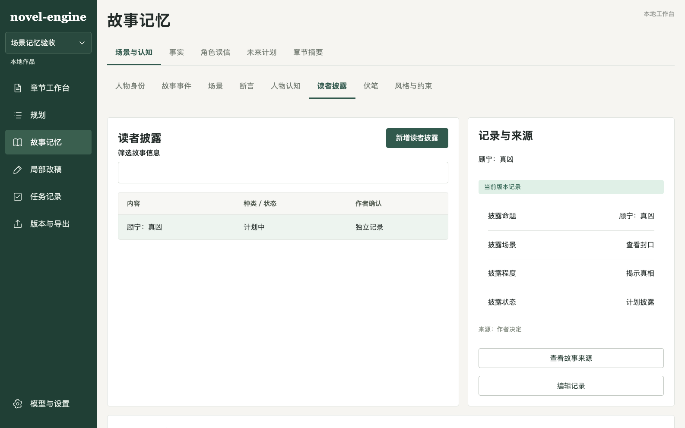
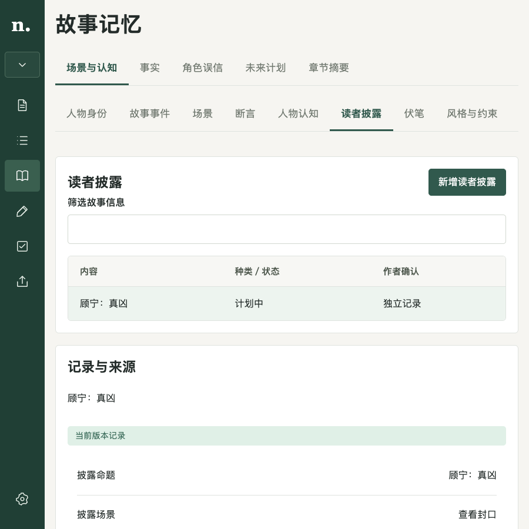

# 小说记忆系统工程验收

记录时间：2026-10-31 11:15（北京时间）。代码基线为 `0194ecd`，本轮变更保留在工作区，没有新增 Git 提交、推送或部署。执行范围见 [N1～N8 计划](story-memory-plan.md)。

## 交付状态

| 阶段 | 当前结果 |
| --- | --- |
| N1 | 场景、事件、断言类型、人物认知、读者披露、伏笔、来源与规则契约已实现 |
| N2 | 版本快照、旧格式映射、CLI／动作接口、迁移前备份与历史兼容通过 |
| N3 | `story-v1` 上下文、各 Agent 的不同读取范围、原文片段、硬约束和预算选择通过 |
| N4 | 场景顺序写作、任务内候选衔接、整章审稿抽取、独立记忆采纳与确认、恢复通过 |
| N5 | 来源与下游失效、纠正链保护、事务内待同步队列、未知操作保护通过 |
| N6 | 现有规划、记忆、章节、改稿、任务和设置页面完成接入与浏览器回归 |
| N7 | Hindsight 接口适配和离线替身验证通过；真实准入未通过，产品入口禁用 |
| N8 | 工程回归、编译入口、中文评测材料草案与比较工具已交付；真实效果验收未完成 |

工程完成不等于整份计划的真实产品验收完成。没有真实服务、完整费用记录与人工标签时，不宣称长篇召回、提前揭示率或修稿时间已经改善。

## 验证证据

- `npm run check`：核心与浏览器 TypeScript 检查通过。
- `npm test`：25 个文件，共 180 项离线测试通过；基线为 119 项。测试环境禁止 fetch 与 Socket 外部连接。
- `npm run build`：核心、CLI、服务端与 React 工作台构建通过。
- `node dist/cli/main.js doctor --offline`：通过，没有模型调用。
- `npm run test:web`：11 项流程通过，使用本地固定响应、真实 SQLite 和 Google Chrome；保留旧的规划、锁定、部分采纳、撤回、历史导出、取消与恢复回归。
- 编译后 CLI 在独立临时作品完成：启用故事状态、场景规划与批准、两场景生成和整章审稿、正文批准、指定场景上下文、只读重放、历史版本导出。正式版本为 3，重放 `databaseChanges=0`，两段场景正文均进入导出。
- `story service-status`：`enabled=false`；`evaluation story-status`：`ready=false`、`qualityPassed=false`，没有把未验收条件标成通过。

新回归涵盖：

| 计划场景 | 主要证据入口 |
| --- | --- |
| C01～C03、C06～C08 | [领域规则](../../tests/story-memory.test.ts)、[场景上下文](../../tests/story-context.test.ts) |
| C04、C14 | [混合引用与硬约束预算](../../tests/story-context.test.ts)、[假来源与服务返回](../../tests/hindsight.test.ts) |
| C05、C13 | [稳定身份与旧快照迁移](../../tests/story-storage.test.ts)、原有 workspace／reliability 回归 |
| C09、C12 | [场景中断与预算](../../tests/story-workflow.test.ts)、[实际部分选择](../../tests/story-selection.test.ts)、原有在途请求与截断恢复回归 |
| C10、C11 | [依赖失效与队列事务](../../tests/story-invalidation.test.ts)、[撤回与历史](../../tests/story-selection.test.ts) |
| 认知和披露作者操作 | [浏览器闭环](../../tests/browser/story-memory.spec.ts) |
| 效果证据不可混用 | [成对评测门槛](../../tests/story-evaluation.test.ts) |

## 工作台与实际输入

浏览器闭环创建稳定人物、事件顺序、真凶设定与角色误信，记录人物获知时机，编辑两个有限视角场景后生成并批准正文；随后采纳章级记忆、批量确认断言、移动获知事件、设置延后披露，并检查关闭未保存表单的保护。

章节页展示该候选实际保存的 Writer 输入；历史输入不会因当前记忆编辑而改变。正文、摘要与 Reviewer 全局反馈不能通过旧章上下文入口绕过场景过滤。相同运行内的前序场景候选明确标为临时材料，只有视角和事件范围匹配时才用于衔接。修订整章会重新生成场景，避免复用依赖旧前序场景的候选。

已检查桌面 1586 × 992 与 900 像素窄窗口截图；1024 像素宽度也由浏览器检查覆盖。截图为实际本地工作台，不是概念图。

## 保留的限制

1. Hindsight 真实服务、中文召回、完整内部预算、取消与重启恢复尚未验证。官方复核与默认禁用原因见 [准入记录](hindsight-admission.md)。没有安装全局服务或修改真实模型配置。
2. 没有使用真实模型凭据。生成、审稿和抽取的工程流程通过，不代表模型在开放小说正文上已经达到质量门槛。
3. [开发材料](../../fixtures/story-memory/development.md) 和 [留出草案](../../fixtures/story-memory/holdout.md) 都明确标为工程合成材料；人工标签、独立样本、指标阈值与完整费用记录没有冻结。
4. 已知来源的确定性过滤与字面阻断不能证明语义泄露率为零。未经范围标注的整章／摘要默认省略；未知事件或人物知情需要作者明确，不自动补齐。
5. 旧工作区不自动启用场景语义；显式启用后，旧章保持未知视角与时间。旧运行继续使用保存的协议。
6. 验证环境为 macOS arm64、Node.js 24.22.1；Linux 未实跑。

已核对文档链接、交付截图复制哈希和变更空白格式；本轮临时测试数据库与编译产物已清理，交付截图保留在本文同目录。

本轮未修改真实作品正文、密钥、真实 `.env`、全局配置或线上数据库。新增数据库迁移只在临时工作区验证；现有工作区由作者正常打开时按备份流程升级。
